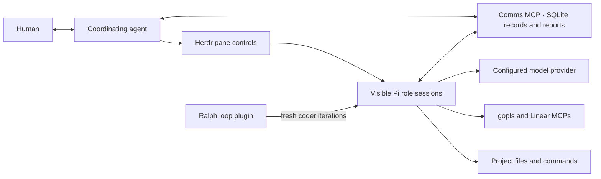

# Tools and tradeoffs

Factory combines role instructions, skills, native agent configuration, and small bookkeeping helpers. The recipes describe how the agents should work together. The coordinator interprets those recipes and makes assignments; no Factory daemon executes them.

The [comms service](../comms/README.md) is the shared Go MCP server with embedded SQLite for tasks, messages, decisions, evidence, usage, and reports. All roles import its skill and connection. Docker Compose stores the database inside the container unless a volume is explicitly mounted. No separate SQLite service is needed.

Herdr is optional: agents can use manually opened sessions. The model provider is selected separately for each role. Agents communicate through the comms MCP inbox tools. Herdr handles live notification, while gopls and Linear are separate task tools.

## External tools

| Component | What it does here | Benefit | Tradeoff |
| --- | --- | --- | --- |
| SQLite Web (optional) | Browser interface for the comms SQLite database. | Table/schema browsing, read-only SQL queries, and exports. | Admin Compose override opts into shared persistent storage. Localhost-only; independent of MCP token authentication. |
| Comms / SQLite | Stores tasks, inbox messages, evidence, decisions, and submitted usage; renders HTML reports. | Shared transactional records through standard MCP tools. | Requires a reachable service. Default data disappears with container removal; explicit volumes provide persistence. Messages do not wake agents and usage is not automatically collected. |
| Pi | Runs interactive role sessions with native model, tool, extension, and MCP configuration. | Reuses an existing agent runtime instead of building one. Each role has its own configuration. | Runnable bundles depend on Pi's CLI and native formats. Switching runners requires an explicit adapter and runner-specific setup. |
| `edxeth/pi-ralph-loop` | Repeats a coder assignment across fresh Pi sessions. | Long assignments can retain durable progress while discarding accumulated conversation history. | One active loop per project workspace, additional model requests, and loss of feedback that was never recorded. Plain-prompt completion depends on the agent's evidence. |
| Herdr | Opens visible panes, names sessions, submits notifications, and exposes terminal output. | Humans can observe agents and intervene directly. | The coordinator must run inside Herdr to use the supplied controls. Input submission does not prove receipt or completion, and terminal output is not a durable handoff. |
| gopls MCP | Exposes Go-aware project exploration and diagnostics through `gopls mcp`. | Gives agents language-aware context alongside source and shell tools. | Requires a compatible installed gopls and working Go project. Each configured session may start a separate process. It is not a substitute for tests or review. |
| Linear MCP | Reads requested issues and related context through Linear's hosted read-only endpoint. | Uses the official service without adding a local bridge or maintaining a Linear API client. | Needs network access and credentials. Tickets can be ambiguous or change after approval; retrieved context must be attributed and reconciled with the task. |
| Go toolchain and golangci-lint | Compile, format, test, and lint the application. | Produce executable verification evidence rather than model predictions. | Must match the application's Go version, module layout, and lint configuration. Existing failures may be unrelated to the task. |
| Python 3.10+ and a POSIX shell | Run Factory's bookkeeping/launch helpers and the optional Go check script. | Standard-library Python avoids a Python package-install step; the scripts remain inspectable. | These are host dependencies. The supplied Go script expects a POSIX shell and a single module root. |
| Git | Can help inspect changes and obtain the pinned Ralph package. | Familiar source inspection and a pinned plugin revision. | Application tasks do not require a Git repository, but fetching the declared Git package needs Git and network access. Committing remains separately authorized. |

Pi supplies normal file and shell tools through each role's `pi/settings.json`. Their presence allows an agent to inspect or change files and run commands; a reviewer prompt does not remove the host account's filesystem permissions. See [session configuration](../orchestrator/README.md) for the actual per-role settings.

The configured gopls connection runs in detached stdio mode and sees saved files, not an editor's unsaved buffers. gopls may invoke Go to load packages, download modules, and write caches. Its MCP support is experimental, so inspect the installed server's advertised tools rather than assuming a fixed catalog. [gopls documentation](https://go.dev/gopls/features/mcp)

Linear is configured for the architect and both reviewers but disabled initially. Its `https://mcp.linear.app/mcp/readonly` endpoint exposes only read tools; the key comes from `LINEAR_API_KEY`. It does not automatically move a ticket to in progress, post results, or create follow-up issues. [Linear documentation](https://linear.app/docs/mcp)

Ralph is a native third-party extension, not a bundled Bash loop or a Factory workflow engine. The coder's settings pin the source revision. Pi can install it in a private runtime profile, which means a newly prepared profile may need to download it again. A local source override can avoid that download. [Ralph integration and limits](../orchestrator/references/ralph.md)

## Included helper tools

These commands are for agents and maintainers. Users normally request their outcomes in conversation.

| File | Responsibility | Important boundary |
| --- | --- | --- |
| [scripts/task.py](../scripts/task.py) | Attaches local artifacts to comms tasks and offers deterministic wrappers for the same MCP tools, including document hashes. | Does not start agents, choose the next stage, poll for replies, or verify work. |
| `agents/<role>/start.sh`, `orchestrator/start.sh` | Start a role using its own bundle through the shared launcher. | Thin entrypoints; task is optional for interactive startup, mandatory for Ralph. No configuration is duplicated in shell. |
| [orchestrator/session.py](../orchestrator/session.py) | Assembles a role's instructions and skills, prepares its native profile, checks startup, and replaces itself with the selected runner. | Starts one interactive session; it is not a supervisor. `--loop N` delegates iterations to the native Ralph plugin. |
| [orchestrator/adapters/pi/profile.py](../orchestrator/adapters/pi/profile.py) | Loads and overlays native JSON configuration, prepares private files, and asks Pi to check credentials, MCPs, and required commands. | An internal library, not another agent launcher or an MCP client implementation. |
| [scripts/factorylib.py](../scripts/factorylib.py) | Checks local artifact identity, publishes local JSON pointers atomically, and records events through comms. | No local mailbox or event store; service access is required for task state. |
| [check-go.sh](../agents/coder_golang/scripts/check-go.sh) | Checks formatting without changing files, runs `go test ./...`, then `golangci-lint run` with supplied arguments. | Fails at the first failing step. Requires `go.mod` in the current directory and installed tools. Does not install dependencies, supply lint configuration, or explicitly run a separate `go vet ./...` command. Prefer project commands when they fit better. |

`task.py` exposes `attach`, `new`, `status`, `send`, `inbox`, `ack`, `decide`, and `note`. `new` creates HTML drafts only for the Go recipe; the writing recipe starts without spec/plan documents. `send` saves first and can then attempt a Herdr notification. A failed notification leaves a valid saved message. `decide` records declared authority and optional document hashes; it does not authenticate the deciding person.

`session.py` supports a read-only `--dry-run`, a native startup `--check`, and an ordinary interactive launch. `--loop N` additionally requires approved current HTML documents, even with `--dry-run`. It supports only the Go coder in the native Pi adapter. Each invocation prepares a new session; invoking it again is not a resume operation. Exact arguments and recovery behavior are in the [operations reference](../orchestrator/references/operations.md) and [Ralph reference](../orchestrator/references/ralph.md).

## Skills, roles, and recipes

A **role** defines responsibilities and authority. A **skill** gives reusable working guidance. A **tool** performs an operation. A **recipe** describes the collaboration. Configuring a skill does not install a tool, and a recipe is not an executable graph.

Every supplied role explicitly imports the shared [task-comms skill](../comms/skills/task-comms/SKILL.md) from the comms directory and receives its role instructions, its recipe, and the full entrypoint text of each skill listed in `config.json`. Supporting references are read when relevant. Explicit inclusion makes behavior inspectable; loading many entrypoints also adds prompt tokens, so keep each role's selection focused.

| Guidance | Included in |
| --- | --- |
| [Conventional commits](../skills/conventional-commits/SKILL.md) | All configured roles, including coordinator. Guides messages and scoped authorized commits; never grants permission to commit. |
| [Evidence-based debugging](../skills/evidence-based-debugging/SKILL.md) | Architect, architecture reviewer, Go coder, and Go code reviewer. |
| [Linear context](../skills/linear-context/SKILL.md) | Architect, architecture reviewer, and Go code reviewer. |
| [Bounded iteration](../skills/bounded-iteration/SKILL.md) | Go coder. |
| [Go quality](../skills/golang/go-code-quality/SKILL.md), [testing](../skills/golang/go-testing/SKILL.md), and [concurrency](../skills/golang/go-concurrency/SKILL.md) | Go coder and Go code reviewer. Applied according to their different responsibilities. |
| [Spec/plan](../agents/architect/skills/spec-and-plan/SKILL.md), [software architecture](../agents/architect/skills/software-architecture/SKILL.md), and [domain modeling](../agents/architect/skills/domain-modeling/SKILL.md) | Architect; specialized guidance is used only where the task warrants it. |
| [Architecture challenge](../agents/architecture_reviewer/skills/architecture-challenge/SKILL.md) | Architecture reviewer. |
| [Go implementation](../agents/coder_golang/skills/go-implementation/SKILL.md) | Go coder. |
| [Go review](../agents/code_reviewer_golang/skills/go-review/SKILL.md) and [critical code review](../agents/code_reviewer_golang/skills/critical-code-review/SKILL.md) | Go code reviewer. |
| [Technical writing](../agents/pair_writer/skills/technical-writing/SKILL.md) and [business writing](../agents/pair_writer/skills/business-writing/SKILL.md) | Interactive pair writer. |

Some skills adapt upstream guidance; their adjacent `SOURCES.md` and `LICENSE` files record attribution and retained notices. These local adaptations do not install or automatically update the upstream collections.

## What this approach buys and costs

The arrangement is small, visible, and easy to customize in a repository. Agents can inspect local documents and use a shared service for task context, humans can intervene in normal sessions, and each team can change roles and recipes directly.

The cost is that coordination is active agent work. Mailboxes do not wake idle agents by themselves. Review limits, single-writer ownership, progress reporting, and most approval behavior are working agreements rather than centrally enforced execution policies. A crashed worker does not automatically update task status, and an idle pane does not establish success.

Native profiles separate runner configuration and transcripts, but all sessions inherit the launcher's environment and retain host permissions. The setup supplies no agent container sandbox, credential filtering, automatic redaction, or authenticated approval service. Comms renders reports from records submitted to its database. It does not automatically collect agent usage; missing measurements remain unknown.

Those limits are relevant when deciding whether this portable setup fits a particular assignment. Use [task records and recovery](task-records.md) to understand the durable evidence and [troubleshooting](troubleshooting.md) when a dependency or handoff fails.

## Optional delivery bridge

[Inbox delivery](../comms/delivery.md) is a small Go host process using the official MCP client and a Herdr CLI adapter. It removes model-based polling and manual idle-agent prompts. Its tradeoffs are an installed Go toolchain (or built binary), execution inside Herdr, explicit captured session bindings, and conservative manual recovery for uncertain terminal input. Notification attempts share comms storage; the bridge has no workflow scheduler or private task database. Live session identity/contact monitoring remains separate work.
